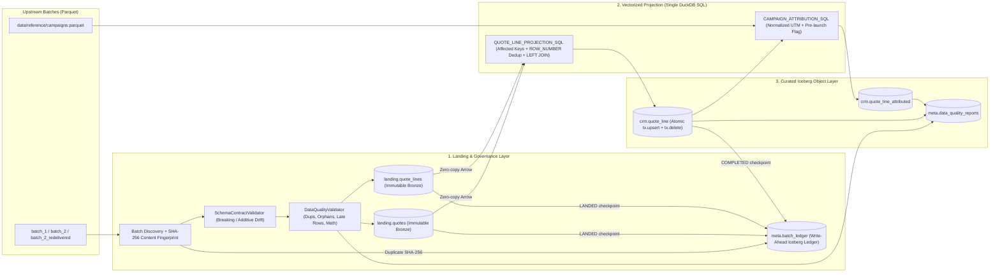
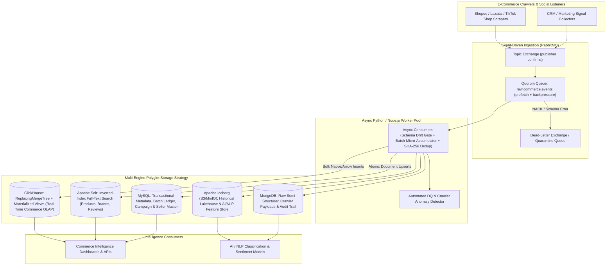

# PulseLine Lakehouse

An incremental, crash-resilient **Commerce & CRM ELT Lakehouse** built with **Python 3.12**, **Apache Iceberg (PyIceberg)**, **DuckDB**, and **PyArrow**.

PulseLine ingests messy, out-of-order upstream Parquet batches into immutable Iceberg bronze tables, validates schema contracts and data quality anomalies, projects deduplicated current state via a single vectorized DuckDB SQL query, merges updates and soft deletes atomically into curated Iceberg tables, and materializes marketing UTM campaign attribution.

---

## Key Capabilities

- **Zero Data Loss on Out-of-Order & Late Data:** Append-only bronze landing (`landing.quotes`, `landing.quote_lines`) without event-time watermark filtering; resolves within-batch duplicates, late-arriving rows below high-watermarks, header-only updates, and delayed parent records deterministically via `(updated_at DESC, _batch_id DESC, _row_num DESC)`.
- **Content-Addressed Idempotency:** Streaming **SHA-256** fingerprinting across batch payloads in `meta.batch_ledger` skips redelivered batches even when renamed (`SKIPPED_DUPLICATE`), producing zero duplicate bronze rows and zero redundant snapshots.
- **Two-Phase Crash Recovery:** Write-Ahead Ledger checkpoints (`LANDED -> COMPLETED`) resume failed runs directly at projection/merge without re-appending already-landed data.
- **Schema Drift & Data Quality Observability:** `SchemaContractValidator` fails fast on breaking drift (missing columns / type mismatches) while absorbing additive columns via Iceberg `union_by_name`. `DataQualityValidator` logs structured JSON telemetry and persists anomaly reports into `meta.data_quality_reports`.
- **Campaign UTM Attribution Mart:** Enriches live quote lines against `reference.campaigns` into `crm.quote_line_attributed`, tagging organic, matched, unknown, and pre-launch (`quote_date < started_on`) traffic explicitly.
- **Built-In Observability & Benchmarking:** CLI subcommands for warehouse inspection (`pipeline inspect`) and 100k-line synthetic latency/throughput profiling (`pipeline benchmark`).

---

## Local Lakehouse Architecture



### Reliability Guarantees

| Guarantee | Mechanism |
|---|---|
| **Zero data loss on late / out-of-order data** | No event-time watermark filtering; every unseen batch lands verbatim and deduplication resolves latest state by `(updated_at DESC, _batch_id DESC, _row_num DESC)`. |
| **Exactly-once idempotency (even under renamed redeliveries)** | Streaming SHA-256 content digest across both Parquet files recorded in `meta.batch_ledger`; identical redeliveries (`batch_2_redelivered`) become `SKIPPED_DUPLICATE` with zero new Iceberg snapshots. |
| **Crash recovery without bronze duplication** | Two-phase ledger state (`LANDED` -> `COMPLETED`): if a worker crashes after appending bronze data but before `crm.quote_line` commits, the next run skips re-landing and resumes at DuckDB projection + atomic Iceberg transaction. |
| **Schema drift & anomaly observability** | Missing columns or type changes fail fast (`SchemaDriftError`); additive columns evolve `landing.*` safely via Iceberg `union_by_name` while logging structured warnings to `meta.data_quality_reports` and JSON logs. |

---

## Quickstart

Requires **Python 3.12** and [uv](https://docs.astral.sh/uv/). Everything runs locally without cloud accounts or external services.

```bash
# Install pinned dependencies
uv sync

# Run full test suite (11 tests covering anomalies, idempotency, recovery, schema drift & attribution)
uv run pytest -v

# Execute incremental lakehouse pipeline
uv run pipeline run --incoming data/incoming --warehouse warehouse --json-logs

# Inspect Iceberg table counts, snapshots, batch ledger, and DQ anomalies
uv run pipeline inspect --warehouse warehouse

# Run 100k-line synthetic latency & throughput benchmark
uv run pipeline benchmark --quotes 20000 --lines 100000 --delta-lines 2000
```

### Optional Linux Scripts & Docker

```bash
# POSIX operational scripts
bash scripts/run_pipeline.sh data/incoming warehouse
bash scripts/verify_and_bench.sh

# Multi-stage container build
docker build -t pulseline-lakehouse .
docker run --rm -v "$(pwd)/data:/data" pulseline-lakehouse
```

---

## Measured Benchmarks (100k-Line Workload)

Measured locally via `uv run pipeline benchmark --quotes 20000 --lines 100000 --delta-lines 2000`:

| Stage | Input Rows | Live Rows | Mutated | Total (ms) | DuckDB Proj (ms) | Iceberg Merge (ms) | Throughput |
|---|---:|---:|---:|---:|---:|---:|---:|
| `initial_load_incremental` | 120,001 | 100,000 | 100,000 | 4,523.2 | 527.7 | 2,402.9 | 26,530 rows/s |
| `delta_batch_incremental_merge` | 3,000 | 101,134 | 4,534 | 2,743.9 | 232.2 | 1,730.3 | 1,093 rows/s |
| `redelivered_batch_noop` | 3,000 | 101,134 | 0 | 439.5 | 0.0 | 0.0 | 6,825 rows/s |
| `full_refresh_rebuild` | 123,000 | 101,134 | 101,134 | 926.8 | 253.0 | 186.6 | 132,720 rows/s |

See [SOLUTION.md](SOLUTION.md) for the complete analysis of dataset anomalies, trade-offs, and Copy-on-Write merge write-amplification findings.

---

## Production Scale-Out Blueprint

The exact design principles implemented locally in PulseLine Lakehouse map cleanly to a high-throughput, multi-engine e-commerce intelligence and marketing analytics platform processing billions of monthly events:



### How Each Local Pattern Translates to Production Infrastructure

1. **Event-Driven Ingestion & Backpressure (`RabbitMQ`):**
   - Replace directory polling (`discover_batches`) with **RabbitMQ Quorum Queues** using topic routing keys (`commerce.<marketplace>.<entity>`).
   - **Zero data loss:** Publisher confirms + durable queues + manual consumer `basic_ack` *only after* the micro-batch commits to storage and the MySQL ledger.
   - **Backpressure:** Bounded `basic_qos(prefetch_count=N)` per async worker and adaptive micro-batching (flush every `10,000` messages or `500 ms`) prevent ClickHouse "Too many parts" errors and memory OOMs.
   - **Failure isolation:** Malformed payloads or breaking schema drifts route via `basic_nack(requeue=False)` to a **Dead-Letter Exchange (DLX)** for replay after parser fixes.

2. **Real-Time Aggregation Queries (`ClickHouse`):**
   - Local DuckDB `ROW_NUMBER() OVER (PARTITION BY id ORDER BY updated_at DESC)` + Iceberg CoW `upsert`/`delete` maps directly to ClickHouse **`ReplacingMergeTree(updated_at, is_deleted)`**:
     - `PARTITION BY toYYYYMM(event_date)`
     - `ORDER BY (channel, brand_id, product_sku, entity_id)` for sub-second brand, SKU, and category rollups.
     - Pre-aggregated **Materialized Views** (`SummingMergeTree` / `AggregatingMergeTree`) serve GMV, units sold, and price-band trends in `< 50 ms` without scanning raw billions of rows.
     - Replaces Copy-on-Write rewrite amplification (measured at `1,730 ms` for 4.5k mutations on 100k rows locally) with sequential append-only part merges.

3. **Transactional Metadata & Raw Payload Governance (`MySQL` + `MongoDB`):**
   - **MySQL:** Hosts the transactional equivalent of `meta.batch_ledger`, `reference.campaigns`, crawler schedules, and user/workspace configs with indexed `(content_sha256)` unique constraints for O(1) distributed idempotency across worker replicas.
   - **MongoDB:** Stores immutable raw scraped JSON/HTML documents (the document-store analog of `landing.*` with natural additive schema flexibility) indexed on `(source, crawled_at)` with TTL archival to S3/Iceberg cold storage.

4. **Full-Text Search & Indexing (`Apache Solr`):**
   - Synchronize normalized product titles, SKU descriptions, seller names, and Vietnamese tokenized brand/review text into **Apache Solr** collections via batched soft-commits (`commitWithin=5000ms`), tuning inverted-index analyzers (`StandardTokenizer`, Vietnamese folding/synonym filters, `docValues=true` on facet/sort fields) and monitoring GC/filterCache hit ratios.

5. **Pipeline Observability, Crawler Anomaly Detection & AI/NLP Supply:**
   - The `meta.data_quality_reports` + structured JSON log architecture scales directly to **Prometheus + Grafana** metrics (`ingest_lag_seconds`, `dq_anomaly_rate`, `schema_drift_events_total`, `dlq_depth`), triggering PagerDuty/Slack alerts on sudden crawler volume drops (>30% WoW), price/quantity outliers, or upstream DOM/schema changes.
   - Clean, deduplicated Iceberg snapshots supply reproducible, time-travel-capable training datasets directly to the **AI/NLP team** without impacting live ClickHouse or MySQL serving latency.

---

## Project Structure

```text
├── src/pipeline/
│   ├── catalog.py        # SQLite-backed PyIceberg SqlCatalog loader (POSIX + Windows)
│   ├── schema.py         # PyArrow & Iceberg schemas (source, landing, ledger, DQ, target, attribution)
│   ├── config.py         # Runtime pipeline configuration dataclasses
│   ├── logging_utils.py  # Structured JSON logger and per-stage latency telemetry
│   ├── quality.py        # SchemaContractValidator & DataQualityValidator
│   ├── landing.py        # Verbatim bronze ingestion, SHA-256 dedup, write-ahead ledger
│   ├── projection.py     # Single DuckDB SQL projection & campaign attribution queries
│   ├── merge.py          # Atomic PyIceberg transaction upsert/delete & mart sync
│   ├── run.py            # PipelineOrchestrator & entrypoint
│   ├── benchmark.py      # Synthetic multi-batch scale-up benchmark harness
│   └── cli.py            # CLI (`pipeline run`, `pipeline inspect`, `pipeline benchmark`)
├── tests/
│   ├── test_smoke.py     # CLI & schema contract smoke tests
│   └── test_pipeline.py  # End-to-end anomaly, idempotency, recovery, drift & attribution tests
├── scripts/
│   ├── run_pipeline.sh
│   └── verify_and_bench.sh
├── Dockerfile            # Multi-stage uv + Python 3.12 runtime image
└── SOLUTION.md           # Detailed data findings, design decisions, and benchmark analysis
```
