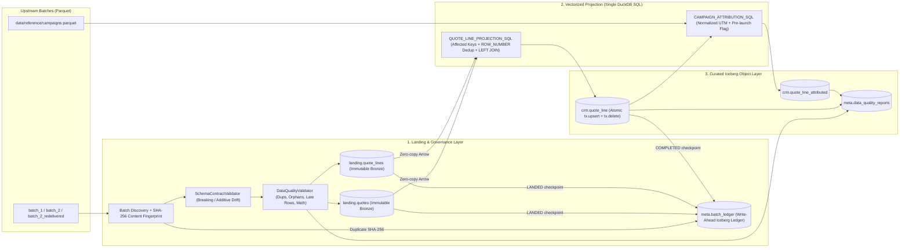
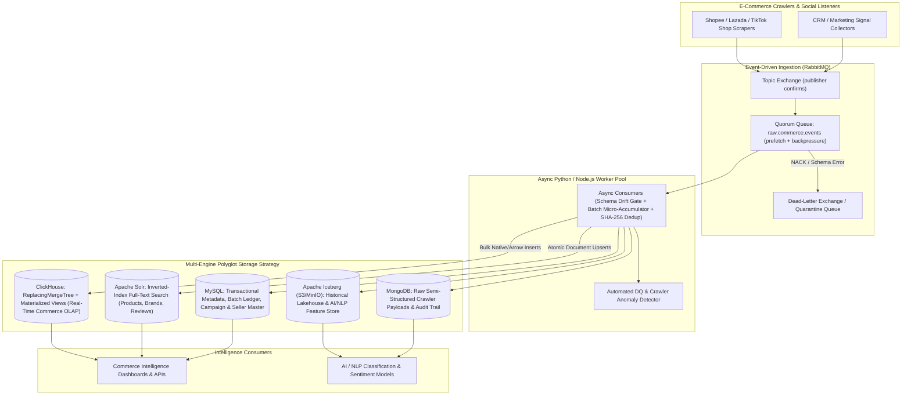

# PulseLine Lakehouse


**PulseLine Lakehouse** is a production-patterned, incremental **Commerce & CRM ELT Lakehouse** built with **Python 3.12**, **Apache Iceberg (PyIceberg)**, **DuckDB**, and **PyArrow**.

---

## Introduction & Problem Statement

In real-world commerce and CRM pipelines, upstream change-data exports rarely arrive cleanly:

- **Duplicate versions** of the same record arrive out of timestamp order inside a single file.
- **Child records** (quote lines) arrive in an earlier batch than their **parent record** (quote header).
- **Late-arriving events** carry timestamps older than the previous batch's high-watermark.
- **Parent-only updates** change quote statuses without re-emitting untouched child lines.
- **Soft deletes** require removing records from live serving tables without losing historical auditability.
- **Redelivered batches** show up under new filenames or directory names with identical payloads.
- **Upstream schema drift** introduces unexpected columns or breaking type changes silently.

**PulseLine Lakehouse** solves all of these deterministically in a lightweight, zero-infrastructure local Iceberg lakehouse (`SQLite SQL catalog + Parquet + DuckDB`), while applying the exact same architectural primitives—content-addressed idempotency, write-ahead checkpoints, automated data quality observability, and vectorized projections—that scale horizontally to billions of monthly e-commerce events.

---

## Architecture Overview

PulseLine follows a three-layer Iceberg lakehouse pattern (**Bronze Landing -> Single-SQL DuckDB Projection -> Atomic Curated Object Merge**) guarded by an automated data quality & schema-drift layer and a two-phase Write-Ahead Batch Ledger:



### How Each Stage Works

1. **Batch Discovery & Content Fingerprinting (`src/pipeline/landing.py`):**
   Scans `--incoming` in lexicographical arrival order and computes a streaming **SHA-256** digest across `quotes.parquet` and `quote_lines.parquet`. Any batch whose `batch_id` is already `COMPLETED`, or whose SHA-256 matches an already-ingested batch under a different name (e.g., `batch_2_redelivered`), is skipped with zero Iceberg writes.
2. **Schema Drift & Pre-Landing Data Quality (`src/pipeline/quality.py`):**
   - **Breaking drift** (missing required columns or type mismatches) fails fast with `SchemaDriftError`.
   - **Additive drift** (unexpected extra columns) logs a `WARNING` and evolves the Iceberg landing schema automatically via `update_schema().union_by_name(...)` (or fails fast with `--strict-schema`).
   - Pre-landing checks flag within-batch duplicates, null keys, invalid quote statuses, arithmetic errors (`quantity * unit_price_vnd != line_total_vnd`), late-arriving timestamps below prior high-watermarks, and lines arriving before their parent quote.
3. **Verbatim Bronze Landing & Write-Ahead Recovery (`meta.batch_ledger`):**
   Raw rows are appended verbatim to `landing.quotes` and `landing.quote_lines` alongside `_batch_id`, `_row_num`, and `_ingested_at`. Writing a `LANDED` checkpoint immediately after bronze append guarantees crash recovery: if a failure occurs before target merge commits, the next run resumes directly at projection/merge without duplicating bronze rows.
4. **Single-Query Vectorized Projection (`src/pipeline/projection.py`):**
   One DuckDB SQL query (`QUOTE_LINE_PROJECTION_SQL`) operates directly on zero-copy PyArrow buffers:
   - Computes the **closed affected key set**: lines in newly landed batches `UNION` historical lines whose `quote_id` appeared in newly landed quotes (propagating header-only updates and late parent arrivals).
   - Deduplicates both entities via `ROW_NUMBER() OVER (PARTITION BY id ORDER BY updated_at DESC, _batch_id DESC, _row_num DESC) = 1`.
   - Joins via `LEFT JOIN` so child lines arriving ahead of their quote header are never silently dropped and are automatically backfilled once the header lands.
5. **Atomic Iceberg Merge & Marketing Attribution (`src/pipeline/merge.py`):**
   - Applies live row upserts (`tx.upsert(..., join_cols=["quote_line_id"])`) and soft-delete removals (`tx.delete(In(...))`) inside a single atomic PyIceberg transaction on `crm.quote_line`.
   - When `campaigns.parquet` is present, synchronizes `reference.campaigns` and materializes `crm.quote_line_attributed` via normalized `(utm_source, utm_campaign)` joins, tagging each line as `attributed`, `attributed_pre_launch` (`quote_date < started_on`), `unattributed`, `partial_utm`, or `unknown_utm`.

---

## Lakehouse Data Model

| Iceberg Table | Layer | Write Strategy | Purpose |
|---|---|---|---|
| `landing.quotes` | Bronze | Append-only (+ schema evolution) | Verbatim quote header change history with ingestion lineage |
| `landing.quote_lines` | Bronze | Append-only (+ schema evolution) | Verbatim quote line change & soft-delete history with lineage |
| `crm.quote_line` | Silver / Object | Atomic `upsert` + `delete` transaction | One live row per `quote_line_id` reflecting latest line & quote state |
| `reference.campaigns` | Reference | Hash-guarded idempotent sync | Marketing campaign metadata keyed by UTM source & campaign |
| `crm.quote_line_attributed` | Gold / Mart | Idempotent overwrite on change | Live quote lines enriched with campaign attribution & quality status |
| `meta.batch_ledger` | Governance | Append-only state log | Tracks `LANDED` / `COMPLETED` / `SKIPPED_DUPLICATE` / `FAILED` + SHA-256 |
| `meta.data_quality_reports` | Observability | Append-only audit log | Persists every schema, pre-landing, post-merge, and attribution check |

---

## Data Hazards Verified on Sample Dataset

Running PulseLine over `data/incoming/` (`batch_1`, `batch_2`, `batch_2_redelivered`) and `data/reference/campaigns.parquet` automatically detects and resolves every planted upstream anomaly:

| Anomaly | Real Example in Dataset | Resolution |
|---|---|---|
| Within-batch out-of-order duplicate | `L000025` in `batch_1` (row 25 `qty=8` at `09:09`, row 299 `qty=5` at `06:09`) | Newer timestamp (`qty=8`) wins; flagged in DQ report |
| Child arrives before parent quote | `L000297`, `L000298` (`Q0121`) in `batch_1`; `Q0121` arrives in `batch_2` | Preserved in `batch_1` via `LEFT JOIN`; backfilled in `batch_2` |
| Late-arriving row below watermark | `L000366` in `batch_2` (`2026-09-05 14:30` < `batch_1` max `2026-09-09`) | Ingested without watermark loss; joined to `batch_1` `Q0005` |
| Header-only & timestamp-only updates | 15 quotes updated in `batch_2` (10 with zero lines in `batch_2`, e.g. `Q0007`, `Q0053`) | All untouched sibling lines refreshed via affected-key scoping |
| Soft deletes | `L000047` live in `batch_1`, `is_deleted=True` in `batch_2` | Atomically deleted from `crm.quote_line`; cannot be resurrected by stale events |
| Renamed batch redelivery | `batch_2_redelivered` byte-for-byte identical to `batch_2` | Skipped via SHA-256 digest (`SKIPPED_DUPLICATE`); 0 snapshots added |
| Pre-launch campaign attribution | 6 `CMP-04` (`zalo/partner_webinar`) quotes dated before `started_on` (`2026-09-02`) | Attributed with `attribution_status = 'attributed_pre_launch'` + DQ warning |

---

## Quickstart & CLI Reference

Requires **Python 3.12** and [uv](https://docs.astral.sh/uv/). Everything runs locally without cloud accounts or external services.

```bash
# 1. Install pinned dependencies
uv sync

# 2. Run the full test suite (11 tests, 0 warnings)
uv run pytest -v

# 3. Execute incremental pipeline with structured JSON observability logs
uv run pipeline run --incoming data/incoming --warehouse warehouse --json-logs

# 4. Inspect tables, snapshots, batch ledger, and DQ anomalies
uv run pipeline inspect --warehouse warehouse

# 5. Run synthetic scale-up latency & throughput benchmark
uv run pipeline benchmark --quotes 20000 --lines 100000 --delta-lines 2000
```

### CLI Options

- `pipeline run --incoming <dir> --warehouse <dir>`
  - `--campaigns <path>` — explicit path to `campaigns.parquet` (auto-discovered at `<incoming>/../reference/campaigns.parquet` by default)
  - `--full-refresh` — rebuild `crm.quote_line` from all landed rows
  - `--strict-schema` — fail on additive (extra) upstream columns
  - `--json-logs` — emit single-line JSON telemetry records for log aggregators
- `pipeline inspect --warehouse <dir> [--json]` — print warehouse table counts, Iceberg snapshot counts, batch ledger history, and DQ warnings/errors
- `pipeline benchmark [--quotes N --lines M --delta-lines K --json]` — generate multi-batch synthetic workloads and measure stage latency and throughput

### Sample Output (`uv run pipeline inspect --warehouse warehouse`)

```text
Iceberg Tables:
  - landing.quotes               rows=166    snapshots=2
  - landing.quote_lines          rows=388    snapshots=2
  - crm.quote_line               rows=365    snapshots=1
  - crm.quote_line_attributed    rows=365    snapshots=1
  - meta.batch_ledger            rows=5      snapshots=5
  - meta.data_quality_reports    rows=28     snapshots=1

Batch Ledger:
  - batch_2                COMPLETED          q=46   l=89   | Projected and merged into crm.quote_line
  - batch_1                COMPLETED          q=120  l=299  | Projected and merged into crm.quote_line
  - batch_2_redelivered    SKIPPED_DUPLICATE  q=0    l=0    | Content SHA-256 identical to already-ingested batch 'batch_2'
  - batch_2                LANDED             q=46   l=89   | Landed verbatim into Iceberg bronze tables
  - batch_1                LANDED             q=120  l=299  | Landed verbatim into Iceberg bronze tables

Data Quality Warnings/Errors (5):
  - [batch_1] quote_lines_within_batch_duplicates (1): Duplicate quote_line_ids within batch (resolved by updated_at DESC): ['L000025']
  - [batch_1] quote_lines_missing_parent_quote (2): 2 line(s) arrived before parent quote header: ['L000297->Q0121', 'L000298->Q0121']
  - [batch_2] quote_lines_late_arriving_below_watermark (1): 1 late-arriving line(s) older than prior max 2026-09-09 21:44:34: ['L000366']
  - [batch_2_redelivered] batch_content_deduplication (1): Skipped redelivered batch 'batch_2_redelivered' (identical SHA-256 to 'batch_2')
  - [campaign_attribution] attribution_pre_launch_quotes (6): 6 quote(s) have quote_date < campaign.started_on: ['Q0026', 'Q0032', 'Q0033', 'Q0039', 'Q0067', 'Q0073']
```

### Optional Linux Scripts & Docker

```bash
# POSIX operational scripts
bash scripts/run_pipeline.sh data/incoming warehouse
bash scripts/verify_and_bench.sh

# Multi-stage container build (Python 3.12 + uv)
docker build -t pulseline-lakehouse .
docker run --rm -v "$(pwd)/data:/data" pulseline-lakehouse
```

---

## Measured Benchmarks (100k-Line Workload)

Measured locally via `uv run pipeline benchmark --quotes 20000 --lines 100000 --delta-lines 2000`:

| Stage | Input Rows | Live Rows | Mutated | Total (ms) | DuckDB Proj (ms) | Iceberg Merge (ms) | Throughput |
|---|---:|---:|---:|---:|---:|---:|---:|
| `initial_load_incremental` | 120,001 | 100,000 | 100,000 | 4,523.2 | 527.7 | 2,402.9 | 26,530 rows/s |
| `delta_batch_incremental_merge` | 3,000 | 101,134 | 4,534 | 2,743.9 | 232.2 | 1,730.3 | 1,093 rows/s |
| `redelivered_batch_noop` | 3,000 | 101,134 | 0 | 439.5 | 0.0 | 0.0 | 6,825 rows/s |
| `full_refresh_rebuild` | 123,000 | 101,134 | 101,134 | 926.8 | 253.0 | 186.6 | 132,720 rows/s |

**Performance finding:** Vectorized DuckDB projection stays sub-quarter-second (`232 ms`) at 123k rows, and content-hash redelivery skips incur `0.0 ms` projection/merge cost. On an unpartitioned Copy-on-Write Iceberg table, PyIceberg `upsert` + `delete` rewrites the file twice (`1,730 ms`)—demonstrating why bucket/date partitioning + Merge-on-Read delete files (or ClickHouse `ReplacingMergeTree`) is essential at billions-of-rows scale. See [SOLUTION.md](SOLUTION.md) for the full technical analysis.

---

## Test Suite Coverage

`uv run pytest -v` executes **11 automated tests (0 warnings)** covering:

- Exact resolution of all 7 planted dataset anomalies (`L000025`, `Q0121`, `L000366`, `L000047`, header/timestamp-only updates, `batch_2_redelivered`, and `CMP-04` pre-launch attribution).
- Exact row-for-row equivalence between batch-by-batch incremental ingestion, single-shot ingestion, and `--full-refresh`.
- Strict snapshot idempotency across re-runs and renamed batch redeliveries.
- Out-of-order stale updates, soft-delete non-resurrection by stale rows, intentional resurrection by newer rows, and deterministic timestamp tie-breaking.
- Simulated mid-run crash recovery from `LANDED` state without duplicating bronze rows.
- Breaking schema drift rejection (`SchemaDriftError`) and additive schema drift evolution (`union_by_name`).
- Campaign attribution mart accuracy, empty-directory initialization, and CLI `inspect`/`benchmark` JSON contracts.

---

## Production Scale-Out Blueprint

The exact reliability and data-governance primitives implemented locally map cleanly to a high-throughput, multi-engine e-commerce intelligence and marketing analytics platform processing billions of monthly events:



### Local-to-Production Mapping

1. **Event-Driven Ingestion & Backpressure (`RabbitMQ`):** Quorum queues with publisher confirms, bounded `basic_qos(prefetch_count=N)` backpressure, adaptive micro-batching (`10,000` msgs or `500 ms`), manual `basic_ack` after storage commit, and Dead-Letter Exchanges (DLX) for malformed payloads or breaking schema drift.
2. **Real-Time Aggregation Queries (`ClickHouse`):** Local DuckDB deduplication + CoW merge translates to ClickHouse `ReplacingMergeTree(updated_at, is_deleted)` partitioned by `toYYYYMM(event_date)` with `ORDER BY (channel, brand_id, product_sku, entity_id)` and pre-aggregated Materialized Views serving `< 50 ms` dashboard queries.
3. **Transactional Metadata & Raw Payloads (`MySQL` + `MongoDB`):** MySQL enforces distributed SHA-256 idempotency and manages campaign/seller master metadata; MongoDB absorbs raw semi-structured crawler payloads with TTL archival to S3/Iceberg.
4. **Full-Text Search (`Apache Solr`):** Batched soft-commits (`commitWithin=5000ms`) indexing normalized product titles, brands, and Vietnamese-tokenized text with `docValues=true` facets and filterCache tuning.
5. **Observability & AI/NLP Supply:** `meta.data_quality_reports` + JSON telemetry export to Prometheus/Grafana for crawler volume-drop and schema-drift alerts, while Iceberg time-travel snapshots feed reproducible datasets to AI/NLP pipelines without impacting serving engines.

---

## Project Structure

```text
├── src/pipeline/
│   ├── catalog.py        # SQLite-backed PyIceberg SqlCatalog loader (POSIX + Windows)
│   ├── schema.py         # PyArrow & Iceberg schemas (source, landing, ledger, DQ, target, attribution)
│   ├── config.py         # Runtime pipeline configuration dataclasses
│   ├── logging_utils.py  # Structured JSON logger and per-stage latency telemetry
│   ├── quality.py        # SchemaContractValidator & DataQualityValidator
│   ├── landing.py        # Verbatim bronze ingestion, SHA-256 dedup, write-ahead ledger
│   ├── projection.py     # Single DuckDB SQL projection & campaign attribution queries
│   ├── merge.py          # Atomic PyIceberg transaction upsert/delete & mart sync
│   ├── run.py            # PipelineOrchestrator & entrypoint
│   ├── benchmark.py      # Synthetic multi-batch scale-up benchmark harness
│   └── cli.py            # CLI (`pipeline run`, `pipeline inspect`, `pipeline benchmark`)
├── tests/
│   ├── test_smoke.py     # CLI & schema contract smoke tests
│   └── test_pipeline.py  # End-to-end anomaly, idempotency, recovery, drift & attribution tests
├── scripts/
│   ├── run_pipeline.sh
│   └── verify_and_bench.sh
├── Dockerfile            # Multi-stage uv + Python 3.12 runtime image
├── SOLUTION.md           # Deep-dive design notes, anomaly analysis, and trade-offs
└── README.md             # Project documentation, quickstart, and architecture guide
```
