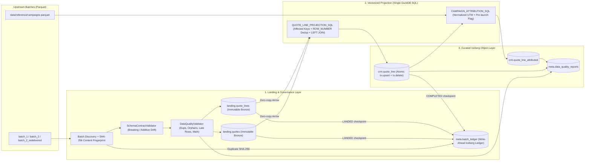
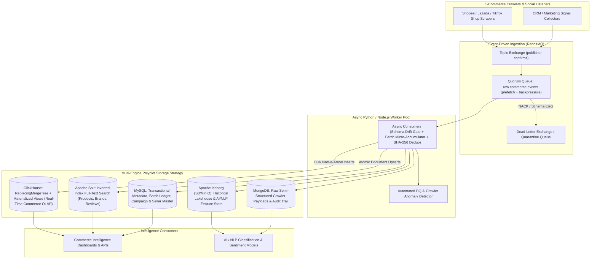

# PulseLine Lakehouse — System Architecture & Production Scale-Out Blueprint

## 1. Local Lakehouse Architecture (Implemented & Verified)

PulseLine Lakehouse implements a zero-dependency-bloat, crash-resilient incremental ELT lakehouse using **Apache Iceberg (PyIceberg 0.12)**, **DuckDB 1.5**, and **PyArrow 24**.

### Key Reliability Guarantees

| Guarantee | Mechanism |
|---|---|
| **Zero data loss on late / out-of-order data** | No event-time watermark filtering; every unseen batch lands verbatim and deduplication resolves latest state by `(updated_at DESC, _batch_id DESC, _row_num DESC)`. |
| **Exactly-once idempotency (even under renamed redeliveries)** | Streaming SHA-256 content digest across both Parquet files recorded in `meta.batch_ledger`; identical redeliveries (`batch_2_redelivered`) become `SKIPPED_DUPLICATE` with zero new Iceberg snapshots. |
| **Crash recovery without bronze duplication** | Two-phase ledger state (`LANDED` -> `COMPLETED`): if a worker crashes after appending bronze data but before `crm.quote_line` commits, the next run skips re-landing and resumes at DuckDB projection + atomic Iceberg transaction. |
| **Schema drift & anomaly observability** | Missing columns or type changes fail fast (`SchemaDriftError`); additive columns evolve `landing.*` safely via Iceberg `union_by_name` while logging structured warnings to `meta.data_quality_reports` and JSON logs. |

---

## 2. Scaling to Billions of Monthly E-Commerce Events (Production Multi-Engine Blueprint)

The exact design principles implemented locally in PulseLine Lakehouse map cleanly to a high-throughput, multi-engine e-commerce intelligence and marketing analytics platform:

### How Each Local Pattern Translates to Production Multi-Engine Infrastructure

1. **Event-Driven Ingestion & Backpressure (`RabbitMQ`):**
   - Replace directory polling (`discover_batches`) with **RabbitMQ Quorum Queues** using topic routing keys (`commerce.<marketplace>.<entity>`).
   - **Zero data loss:** Publisher confirms + durable queues + manual consumer `basic_ack` *only after* the micro-batch commits to storage and the MySQL ledger.
   - **Backpressure:** Bounded `basic_qos(prefetch_count=N)` per async worker and adaptive micro-batching (flush every `10,000` messages or `500 ms`) prevent ClickHouse "Too many parts" errors and memory OOMs.
   - **Failure isolation:** Malformed payloads or breaking schema drifts route via `basic_nack(requeue=False)` to a **Dead-Letter Exchange (DLX)** for replay after parser fixes.

2. **Real-Time Aggregation Queries (`ClickHouse`):**
   - Local DuckDB `ROW_NUMBER() OVER (PARTITION BY id ORDER BY updated_at DESC)` + Iceberg CoW `upsert`/`delete` maps directly to ClickHouse **`ReplacingMergeTree(updated_at, is_deleted)`**:
     - `PARTITION BY toYYYYMM(event_date)`
     - `ORDER BY (channel, brand_id, product_sku, entity_id)` for sub-second brand, SKU, and category rollups.
     - Pre-aggregated **Materialized Views** (`SummingMergeTree` / `AggregatingMergeTree`) serve GMV, units sold, and price-band trends in `< 50 ms` without scanning raw billions of rows.
     - Replaces Copy-on-Write rewrite amplification (measured at `1,730 ms` for 4.5k mutations on 100k rows locally) with sequential append-only part merges.

3. **Transactional Metadata & Raw Payload Governance (`MySQL` + `MongoDB`):**
   - **MySQL:** Hosts the transactional equivalent of `meta.batch_ledger`, `reference.campaigns`, crawler schedules, and user/workspace configs with indexed `(content_sha256)` unique constraints for O(1) distributed idempotency across worker replicas.
   - **MongoDB:** Stores immutable raw scraped JSON/HTML documents (the document-store analog of `landing.*` with natural additive schema flexibility) indexed on `(source, crawled_at)` with TTL archival to S3/Iceberg cold storage.

4. **Full-Text Search & Indexing (`Apache Solr`):**
   - Synchronize normalized product titles, SKU descriptions, seller names, and Vietnamese tokenized brand/review text into **Apache Solr** collections via batched soft-commits (`commitWithin=5000ms`), tuning inverted-index analyzers (`StandardTokenizer`, Vietnamese folding/synonym filters, `docValues=true` on facet/sort fields) and monitoring GC/filterCache hit ratios.

5. **Pipeline Observability, Crawler Anomaly Detection & AI/NLP Supply:**
   - The `meta.data_quality_reports` + structured JSON log architecture scales directly to **Prometheus + Grafana** metrics (`ingest_lag_seconds`, `dq_anomaly_rate`, `schema_drift_events_total`, `dlq_depth`), triggering PagerDuty/Slack alerts on sudden crawler volume drops (>30% WoW), price/quantity outliers, or upstream DOM/schema changes.
   - Clean, deduplicated Iceberg snapshots supply reproducible, time-travel-capable training datasets directly to the **AI/NLP team** without impacting live ClickHouse or MySQL serving latency.
